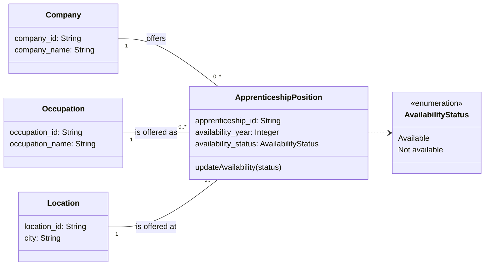

# Yousty Apprenticeship API

Group project for **Information Systems (HS26, FHNW)**: a small prototype for managing the availability of apprenticeship positions on the Yousty platform for 2027. It is adapted from the course starter [Student-API-Basic](https://github.com/DevidMontecchiari/Student-API-Basic) and uses Python, FastAPI and JSON files.

> **Status:** draft for the Milestone 2 + 3 coaching. The data is fictional.

## 1. Scenario

Yousty AG is Switzerland's largest vocational training platform. Training companies advertise apprenticeship positions and mark a starting year as available (shown in green) or not available (red). Yousty does not track this itself: the company has to update it manually.

**Business problem:** Yousty needs a structured way to store and manage availability information, so that the status shown to young people is consistent and accurate.

**Guiding question:** *According to the information provided by the training company, is this apprenticeship position available for 2027?*

**In scope:** companies offering positions for 2027, the occupation offered, the location, and the apprenticeship position with its availability.
**Out of scope:** student management, contracts, recruitment and the application process.

## 2. Models

### Class diagram



Each apprenticeship position belongs to exactly **one** company, **one** occupation and **one** location. A company, occupation or location can have many positions. If a company offers the same occupation in two cities, these are two separate positions.

### Use cases → API operations

| Actor | Use case (UML) | API operation |
| --- | --- | --- |
| Company | Manage Apprenticeship Vacancy | `POST /apprenticeship-positions`, `DELETE /apprenticeship-positions/{id}` |
| Company | Update Availability | `PATCH /apprenticeship-positions/{id}/availability` |
| Company | View own Vacancies | `GET /apprenticeship-positions?company_id=C01` |
| Student | Search Apprenticeships | `GET /apprenticeship-positions` (with optional filters) |
| Student | Filter by Availability | `?availability_status=Available` |
| Student | Starting Year | `?availability_year=2027` |
| Student | View Vacancy Details / Availability Information | `GET /apprenticeship-positions/{id}` |

Register, Manage Profile and Save Vacancy are part of the use case diagram but are **not implemented**. They are outside our data model's scope.

### Example JSON

One record from `data/apprenticeship_positions.json`:

```json
{
  "apprenticeship_id": "A01",
  "occupation_id": "O01",
  "company_id": "C01",
  "location_id": "L01",
  "availability_year": 2027,
  "availability_status": "Available"
}
```

The three foreign keys point to records in `companies.json`, `occupations.json` and `locations.json`. For example, `C01` is *Alpenblick Logistik AG*, `O01` is *Commercial Employee EFZ* and `L01` is *Olten*.

## 3. Run the prototype

**Codespaces (browser):** *Code → Codespaces → Create codespace*, wait for setup, then in the terminal:

```sh
python -m pip install -r requirements.txt
python run.py
```

Open **Ports → 8000 → Open in Browser** and add `/docs` to the address.

**Locally (Python 3.12+):**

```sh
python -m venv .venv
source .venv/bin/activate        # Windows: .\.venv\Scripts\Activate.ps1
python -m pip install -r requirements.txt
python run.py
```

Then open <http://127.0.0.1:8000/docs>. **Ctrl+C** stops the server.

## 4. Project structure

```text
main.py                              API code (data access, logic, routes)
data/companies.json                  Company records
data/occupations.json                Occupation records
data/locations.json                  Location records
data/apprenticeship_positions.json   Apprenticeship positions with availability
run.py                               launcher from the starter (port 8000)
requirements.txt                     FastAPI + Uvicorn
```

`main.py` follows the three layers from the course:

1. **Data access:** `load_records()` and `save_records()` read and write the JSON files.
2. **Application logic:** `find_record()`, `check_references()` and the duplicate check enforce the rules of our model.
3. **Interface:** the `@app.get / post / patch / delete` routes, which you can try out in `/docs`.

## 5. Endpoints

| Method | Path | Purpose |
| --- | --- | --- |
| GET | `/companies`, `/companies/{company_id}` | Read companies |
| GET | `/occupations`, `/occupations/{occupation_id}` | Read occupations |
| GET | `/locations`, `/locations/{location_id}` | Read locations |
| GET | `/apprenticeship-positions` | Read all positions. Optional filters: `availability_status`, `availability_year`, `occupation_id`, `location_id`, `company_id` |
| GET | `/apprenticeship-positions/{apprenticeship_id}` | Read one position |
| POST | `/apprenticeship-positions` | **Create** a position (the ID is assigned automatically) |
| PATCH | `/apprenticeship-positions/{apprenticeship_id}/availability` | **Update** the availability status |
| DELETE | `/apprenticeship-positions/{apprenticeship_id}` | **Delete** a position |

## 6. Checked requests

| Request | Expected | Why |
| --- | --- | --- |
| `GET /apprenticeship-positions/A03` | 200, position A03 | Record exists |
| `GET /apprenticeship-positions/A99` | 404 | Valid ID format, no record |
| `GET /apprenticeship-positions?availability_status=Available&location_id=L03` | 200, only A04 | Combined filter |
| `GET /apprenticeship-positions?availability_status=Maybe` | 422 | Status must be `Available` or `Not available` |
| `POST` with `{"occupation_id":"O02","company_id":"C02","location_id":"L01"}` | 201, new ID `A06`, year 2027, status Available | Create with defaults |
| Same `POST` again | 409 | Same company + occupation + location + year already exists |
| `POST` with `"occupation_id":"O09"` | 422, `Occupation O09 does not exist` | Each position needs an existing occupation |
| `POST` with `"availability_year":"next year"` | 422 | Year must be an integer |
| `PATCH /apprenticeship-positions/A01/availability` with `{"availability_status":"Not available"}` | 200, status changed and saved | Company marks the position as filled |
| `PATCH` with `{"availability_status":"Full"}` | 422 | Not an allowed status |
| `DELETE /apprenticeship-positions/A06` (twice) | 200, then 404 | Removed; the second time it no longer exists |

The write operations change the JSON files. To restore the original example data, discard the changes in GitHub Desktop or run `git checkout -- data/`.

## 7. Design choices

- **String IDs with prefixes** (`C01`, `O01`, `L01`, `A01`), as in our attribute tables. The routes therefore use `str` path parameters, so `abc` returns 404 (not found), not 422.
- **Availability as a status attribute of the position** (assumption 2 and 3 in the report), with two allowed values, `Available` and `Not available`, matching Yousty's green/red years.
- **`availability_year` is an integer** and defaults to 2027, our scope.
- **Foreign-key checks in code:** JSON does not enforce relationships, so `check_references()` rejects positions that point to a company, occupation or location that does not exist.
- **No duplicates:** one company cannot list the same occupation at the same location for the same year twice. This follows assumption 4.
- **Only positions are writable.** Companies, occupations and locations are reference data and read-only in this prototype.
- **Field names in `snake_case`** (`company_id` instead of `Company_id`), following the Python/JSON convention of the starter.

## 8. Limitations

- No login: a `company_id` is a filter, not proof of identity. Any caller could change any company's positions.
- JSON files instead of a database. This is fine for a prototype, but concurrent writes could overwrite each other.
- Only one availability status per position and year. The number of open places is not stored (out of scope).
- Deleting a company, occupation or location is not possible, so the API cannot leave positions with broken references.

## 9. Questions for coaching

1. Should availability stay an attribute of `ApprenticeshipPosition`, or become its own class (e.g. `Availability` with year + status) if more years are added?
2. Is a two-value status (`Available` / `Not available`) enough, or should we model the number of open places?
3. Is the multiplicity `1 … 0..*` right? Our ER diagram shows "one or many" positions per company, but in the prototype a company can have zero positions (e.g. after a delete).
4. Is `PATCH …/availability` the right way to represent the "Update Availability" use case, or should we use `PUT` on the whole position?

## References

- FHNW School of Business (2026). *Information Systems: Data and databases; Information Systems Development* (course material).
- Montecchiari, D. (2026). [Student-API-Basic](https://github.com/DevidMontecchiari/Student-API-Basic), course starter.
- [FastAPI documentation](https://fastapi.tiangolo.com/)
- AI assistance: Claude (Anthropic) was used to help adapt the starter code and draft this README; the group reviewed and tested the result.
